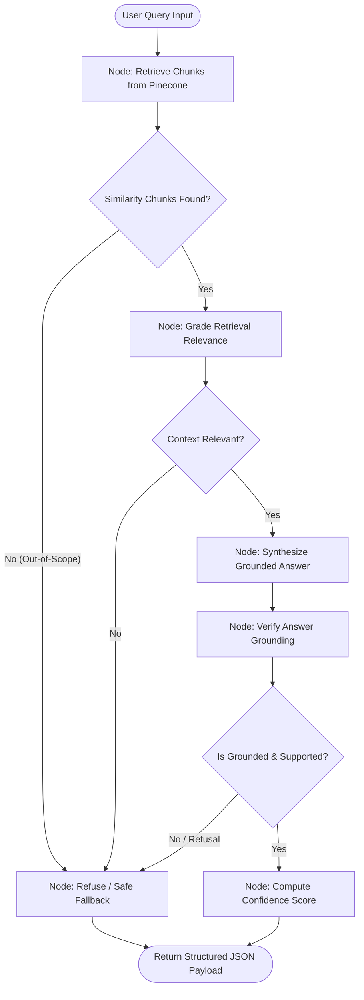

# 🤖 LangGraph & Pinecone RAG Chatbot

An end-to-end, cyclic **Retrieval-Augmented Generation (RAG)** chatbot engineered with **LangGraph**, **Pinecone Serverless Vector Database**, and **Strict Document Grounding**. The system answers questions strictly and exclusively based on the provided document: **[Agentic AI eBook](https://konverge.ai/pdf/Ebook-Agentic-AI.pdf)** published by Konverge AI.

[](https://fastapi.tiangolo.com)
[](https://langchain-ai.github.io/langgraph/)
[](https://www.pinecone.io/)
[](https://streamlit.io/)
[](https://www.python.org/)

---

## 📑 Table of Contents

- [Overview & Architecture](#-overview--architecture)
- [Workflow Graph & State Machine](#-workflow-graph--state-machine)
- [Key Features](#-key-features)
- [Tech Stack](#-tech-stack)
- [Project Directory Structure](#-project-directory-structure)
- [Setup & Installation](#-setup--installation)
- [Data Ingestion Pipeline](#-data-ingestion-pipeline)
- [Running the Services](#-running-the-services)
  - [1. FastAPI REST API](#1-fastapi-rest-api)
  - [2. Interactive Streamlit Dashboard](#2-interactive-streamlit-dashboard)
- [API Specification & Output Payload](#-api-specification--output-payload)
- [Sample Queries & Benchmark Validation](#-sample-queries--benchmark-validation)
- [Running Tests](#-running-tests)
- [Hallucination Prevention & Guardrails](#-hallucination-prevention--guardrails)

---

## 🌟 Overview & Architecture

Modern production RAG requires more than naive semantic search. Naive RAG is vulnerable to hallucination, topic drift, and out-of-scope answering. This system implements an agentic, cyclic workflow using **LangGraph**:

1. **Deterministic Ingestion:** Downloads and parses `Ebook-Agentic-AI.pdf`, decomposes text with `RecursiveCharacterTextSplitter` into 800-character segments with 120-character overlap, and stores dense vector embeddings with complete chunk metadata (source text, page numbers, stable chunk IDs) in **Pinecone**.
2. **Hybrid Semantic Retrieval:** Queries Pinecone for top-$k$ nearest neighbors filtered by a cosine similarity threshold with multi-query intent expansion and reciprocal rank fusion (RRF).
3. **Self-RAG Relevance Grading:** Dynamically checks whether retrieved chunks contain sufficient evidence before invoking generation.
4. **Constrained Answer Generation:** An LLM synthesizes an answer restricted **strictly** to the retrieved context chunks.
5. **Hallucination / Groundedness Verification:** A verification grader validates that every factual claim in the generated answer is supported by the context. Non-grounded answers or out-of-scope queries are immediately routed to a safe refusal fallback.
6. **Confidence Scoring:** Calculates an empirical confidence score balancing retrieval quality (40%) and answer grounding (60%).

---

## 🔄 Workflow Graph & State Machine

The orchestration graph is implemented via `langgraph.graph.StateGraph` with conditional routing:



---

## 🛠️ Key Features

- **Strict Document Grounding:** Never answers from model pre-training weights or external trivia.
- **Provider Agnostic:** Out-of-the-box support for local, open-source execution via **Ollama** (`nomic-embed-text` + `llama3.2`) as well as cloud **OpenAI** (`text-embedding-3-small` + `gpt-4o-mini`).
- **Standardized Payload:** Returns the exact JSON structure specified in the assignment with `query`, `final_answer`, `retrieved_context_chunks`, and `confidence_score`.
- **Dual Interfaces:** Fully documented **FastAPI** REST API with interactive Swagger docs and a modern **Streamlit** dashboard.
- **Automated Ingestion:** Self-fetching data pipeline that downloads the official eBook PDF if missing and indexes all 60 pages into Pinecone.

---

## 💻 Tech Stack

| Component | Technology | Role |
| :--- | :--- | :--- |
| **Orchestration** | **LangGraph** (`>=0.2.0`) | Graph state machine, cyclic edges, conditional routing |
| **Vector DB** | **Pinecone Serverless** (`>=5.0.0`) | Dense vector storage, metadata filtering, cosine similarity |
| **Embeddings** | **Nomic Embed Text** / **OpenAI** | Vector representations (768-dim / 1536-dim) |
| **LLM Inference** | **Llama 3.2** / **GPT-4o-mini** | Answer generation and structured JSON grading |
| **Data Ingestion** | **PyPDF** + **LangChain TextSplitter** | PDF page extraction, sliding window chunking |
| **REST API** | **FastAPI** + **Uvicorn** | High-performance asynchronous API endpoints |
| **Web UI** | **Streamlit** | Interactive UI with benchmark selector and score gauge |
| **Validation** | **Pytest** + **Pydantic v2** | Automated schema validation and grounding tests |

---

## 📂 Project Directory Structure

```text
langgraph-pinecone-rag-chatbot/
├── app/
│   ├── __init__.py
│   ├── config.py              # Pydantic Settings configuration (.env loader)
│   ├── graph.py               # LangGraph state machine & node implementations
│   ├── main.py                # FastAPI REST API endpoints & HTML test console
│   ├── prompts.py             # Grounding, generation & grader system prompts
│   ├── schemas.py             # Pydantic v2 request/response models
│   └── services/
│       ├── __init__.py
│       ├── graders.py         # Relevance & hallucination evaluation logic
│       ├── ingestion.py       # PDF extraction & text chunking utilities
│       ├── retrieval.py       # Pinecone query & reciprocal rank fusion
│       └── vector_store.py    # Pinecone client & serverless index manager
├── data/
│   ├── .gitkeep
│   └── Ebook-Agentic-AI.pdf   # Ingested eBook PDF (downloaded on-demand)
├── scripts/
│   ├── check_pdf.py           # Quick PDF sanity test
│   ├── ingest_pdf.py          # Complete vectorization & Pinecone upsert script
│   ├── test_graph.py          # End-to-end benchmark test runner
│   └── test_retrieval.py      # Standalone retrieval inspector
├── tests/
│   ├── test_cases.json        # 6 assignment benchmark query definitions
│   └── test_pipeline.py       # Automated Pytest test suite
├── .env.example               # Clean environment configuration template
├── .gitignore                 # Git ignore rules (protects keys, venv, large exes)
├── pytest.ini                 # Pytest root configuration
├── requirements.txt           # Pinned dependencies
├── streamlit_app.py           # Interactive Streamlit Web UI
└── README.md                  # Comprehensive documentation
```

---

## 🚀 Setup & Installation

### 1. Clone the Repository

```bash
git clone https://github.com/hemanthkumar3000/langgraph-pinecone-rag-chatbot.git
cd langgraph-pinecone-rag-chatbot
```

### 2. Create and Activate Virtual Environment

```bash
# Windows (PowerShell)
python -m venv venv
.\venv\Scripts\Activate.ps1

# Linux / macOS
python3 -m venv venv
source venv/bin/activate
```

### 3. Install Dependencies

```bash
pip install -r requirements.txt
```

### 4. Configure Environment Variables

Copy `.env.example` to `.env`:

```bash
cp .env.example .env
```

Configure your `.env` file:

```env
# Pinecone API Settings
PINECONE_API_KEY=your_pinecone_api_key_here
PINECONE_INDEX_NAME=agentic-ai-ebook-index-local
PINECONE_CLOUD=aws
PINECONE_REGION=us-east-1

# LLM & Embedding Provider ("ollama" or "openai")
LLM_PROVIDER=ollama

# Ollama Settings (Local & Free)
EMBEDDING_MODEL=nomic-embed-text
CHAT_MODEL=llama3.2
EMBEDDING_DIMENSION=768

# OpenAI Settings (Optional Cloud Alternative)
# OPENAI_API_KEY=sk-...
# OPENAI_CHAT_MODEL=gpt-4o-mini
# OPENAI_EMBEDDING_MODEL=text-embedding-3-small
# OPENAI_EMBEDDING_DIMENSION=1536

# Ingestion & Retrieval Hyperparameters
CHUNK_SIZE=800
CHUNK_OVERLAP=120
TOP_K=5
SIMILARITY_THRESHOLD=0.50
```

> **Note for Local Ollama Users:** Ensure Ollama is running and models are pulled:
> ```bash
> ollama pull nomic-embed-text
> ollama pull llama3.2
> ```

---

## 📥 Data Ingestion Pipeline

To download the eBook PDF and index all chunks into Pinecone:

```bash
python scripts/ingest_pdf.py
```

The script will:
1. Verify if `data/Ebook-Agentic-AI.pdf` exists locally; if not, automatically download it from `https://konverge.ai/pdf/Ebook-Agentic-AI.pdf`.
2. Parse all 60 pages and segment text into overlapping chunks with metadata.
3. Compute dense vector embeddings.
4. Create the Pinecone Serverless index if it doesn't already exist.
5. Upsert vector records in controlled batches of 25.

---

## 🖥️ Running the Services

### 1. FastAPI REST API

Start the backend server with Uvicorn:

```bash
uvicorn app.main:app --reload --host 0.0.0.0 --port 8000
```

- **Interactive API Documentation (Swagger):** [http://localhost:8000/docs](http://localhost:8000/docs)
- **Built-in Web Testing Console:** [http://localhost:8000/](http://localhost:8000/)
- **Health Check Endpoint:** `GET http://localhost:8000/health`
- **Query Endpoint:** `POST http://localhost:8000/query`

### 2. Interactive Streamlit Dashboard

Launch the Streamlit web interface:

```bash
streamlit run streamlit_app.py
```

Features in the Streamlit app:
- 1-Click buttons for all 6 benchmark assignment queries.
- Live execution through the LangGraph state machine.
- Confidence score gauges and groundedness badges.
- Expandable context chunks with source page numbers.
- Raw JSON response viewer matching Section 3.C.

---

## 📡 API Specification & Output Payload

### `POST /query`

**Request Body:**
```json
{
  "query": "What is the core definition of Agentic AI as outlined in the eBook?"
}
```

**Response Payload (Exact Assignment Format):**
```json
{
  "query": "What is the core definition of Agentic AI as outlined in the eBook?",
  "final_answer": "According to the eBook, Agentic AI refers to systems capable of autonomous decision-making and action in pursuit of specific objectives. (Page 18)",
  "retrieved_context_chunks": [
    "[Context Chunk 1] (Source: Ebook-Agentic-AI.pdf | Page: 18)\nA Journey into the Heart of Autonomous Intelligence...\nAgentic AI refers to systems capable of autonomous decision-making and action in pursuit of specific objectives...",
    "[Context Chunk 2] (Source: Ebook-Agentic-AI.pdf | Page: 7)\nIn this section, we will define what Agentic AI is..."
  ],
  "confidence_score": 0.92
}
```

---

## 🧪 Sample Queries & Benchmark Validation

Run the benchmark evaluation runner across the 6 required queries:

```bash
python scripts/test_graph.py
```

### Benchmark Results Summary:

| Category | Query | Expected Behavior | Status |
| :--- | :--- | :--- | :--- |
| **1. Definition & Scope** | *What is the core definition of Agentic AI as outlined in the eBook?* | Defines Agentic AI as systems capable of autonomous decision-making and action in pursuit of specific objectives (Page 18). | ✅ Answered (Grounded) |
| **2. Architecture & Paradigms** | *What are the main architectural components required to build agentic systems?* | Identifies Perception, Reasoning, Planning, Learning, and Execution (Page 17/20). | ✅ Answered (Grounded) |
| **3. Use Cases** | *What real-world industry use cases for Agentic AI are discussed in the eBook?* | Details use cases across manufacturing, retail, healthcare, construction, pharmaceuticals (Page 54). | ✅ Answered (Grounded) |
| **4. Comparison** | *How does Agentic AI differ from traditional generative AI chatbots according to the text?* | Explains autonomy and proactive action vs. passive text generation and rule execution (Page 9/10). | ✅ Answered (Grounded) |
| **5. Challenges & Considerations** | *What key challenges or limitations of Agentic AI are mentioned in the document?* | Highlights system complexity, interoperability, data security, conflict resolution, scalability (Page 36/39). | ✅ Answered (Grounded) |
| **6. Out-of-Scope (Groundedness Check)** | *What is the capital of France?* | Refuses to answer; states information is not available in the eBook context. | 🛡️ Refused (Grounded) |

---

## 🔬 Running Tests

Execute the automated test suite with Pytest:

```bash
pytest tests/ -v
```

The test suite validates:
- `test_health_endpoint`: Confirms the service is healthy.
- `test_out_of_scope_refusal`: Asserts that out-of-scope queries (e.g., "What is the capital of France?") are refused with confidence score `0.0`.
- `test_payload_schema_compliance`: Confirms that response payloads match the exact key structure and data types specified in Section 3.C.
- `test_in_scope_query`: Confirms that in-scope queries retrieve context, generate grounded answers, and produce high confidence scores.

---

## 🛡️ Hallucination Prevention & Guardrails

1. **Pre-Generation Filter:** Chunks with cosine similarity below `SIMILARITY_THRESHOLD` (0.50) are discarded. If zero chunks pass, the graph terminates early at the `refuse` node without spending LLM tokens.
2. **Relevance Gatekeeper:** An LLM relevance evaluator checks whether retrieved chunks contain semantic overlap and useful information for the user question.
3. **Prompt Hardening:** Prompts instruct the generator to rely **exclusively** on the provided context, never extrapolate, and output an explicit refusal phrase if context is insufficient.
4. **Post-Generation Grounding Grader:** Verifies that every factual claim in the generated answer directly maps to the provided context chunks.
5. **Deterministic Confidence Metric:** Calculated as $0.4 \times \text{Retrieval Similarity} + 0.6 \times \text{Grounding Score}$. Ungrounded or refused answers automatically receive a confidence score of `0.0`.

---

## 👤 Author & Submission Details

- **Role:** AI Engineer
- **Project:** LangGraph & Pinecone RAG Chatbot
- **Submission Repository:** [https://github.com/hemanthkumar3000/langgraph-pinecone-rag-chatbot](https://github.com/hemanthkumar3000/langgraph-pinecone-rag-chatbot)
